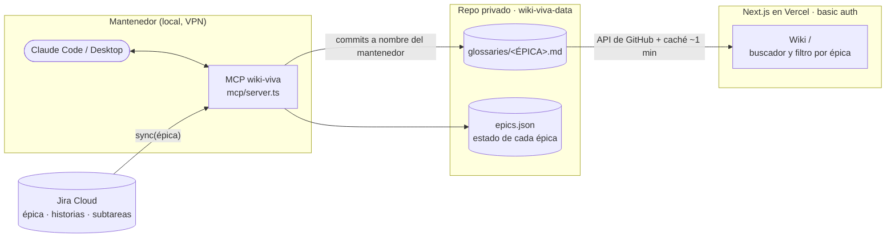

# Wiki viva de terminología

Glosario de negocio por épica de Jira, para resolver dudas de terminología y casos especiales sin tener que preguntarle a un compañero.

- **Mantenedores:** arman y actualizan el glosario conversando con su propio Claude (Claude Code o Desktop) a través del **MCP `wiki-viva`**, en local y con VPN. Claude lee las tarjetas de la épica, propone los términos, los revisa con la persona y los publica con su OK.
- **Todo el equipo:** consulta la **wiki** desplegada (`/`): términos con buscador, filtro por épica, sinónimos, casos especiales y fuentes linkeadas a Jira. Es de solo lectura.

## Arquitectura



La imagen [`docs/arquitectura.png`](docs/arquitectura.png) se regenera desde el bloque de arriba con `npx @mermaid-js/mermaid-cli -i arquitectura.mmd -o docs/arquitectura.png -w 1600 -s 2 -b white`.

- **Los glosarios reales no están en este repo.** Viven en un repo privado (`GLOSSARY_REPO`), uno por épica en `glossaries/<ÉPICA>.md`, porque contienen terminología y reglas de negocio del cliente. Sin `GLOSSARY_REPO`, la wiki usa una carpeta `glossaries/` local (ignorada por git) o [`glossary.example.md`](glossary.example.md), con datos ficticios.
- **Sin IA en el servidor.** El trabajo de IA lo hace el Claude de cada mantenedor; el sitio solo lee. No hace falta key de LLM.
- **Jira solo se lee desde el MCP**, en la PC del mantenedor y con su token: la VPN o la lista de IPs del cliente dejan de ser un problema.
- **Conectores**: toda fuente implementa `SourceConnector` (`src/connectors/types.ts`). Hoy hay uno, Jira (`src/connectors/jira.ts`). Agregar una fuente = un conector nuevo + una entrada en `src/connectors/registry.ts`.

Stack: Next.js 16 (App Router, Cache Components) · TypeScript · Tailwind · MCP TypeScript SDK · Jira Cloud REST API.

## MCP para mantenedores

### Instalación (Claude Code)

```bash
git clone <este repo> && cd wiki-viva
npm install
cp .env.example .env.local   # completar las variables del MCP
claude                       # abrir Claude Code en la carpeta del repo
```

El repo trae [`.mcp.json`](.mcp.json): al abrir Claude Code en la carpeta, ofrece habilitar el servidor `wiki-viva` (verificar con `/mcp`). El MCP lee `.env.local` del repo.

Para **Claude Desktop**, agregar en `claude_desktop_config.json` (con la ruta absoluta del repo):

```json
{
  "mcpServers": {
    "wiki-viva": {
      "command": "node",
      "args": ["<repo>/node_modules/tsx/dist/cli.mjs", "--tsconfig", "<repo>/tsconfig.json", "<repo>/mcp/server.ts"]
    }
  }
}
```

### Credenciales (cada mantenedor las suyas)

| Variable | Para qué |
|---|---|
| `JIRA_BASE_URL`, `JIRA_EMAIL`, `JIRA_API_TOKEN` | Acceso a Jira Cloud con tu API token (https://id.atlassian.com/manage-profile/security/api-tokens). |
| `JIRA_EPIC_JQL` | Opcional. JQL de los hijos de una épica, con `{epic}` en lugar de la clave. Por defecto `parent = {epic}`; en proyectos clásicos, `"Epic Link" = {epic}`. |
| `GLOSSARY_REPO`, `GITHUB_TOKEN` | Repo privado de datos y un fine-grained token tuyo con **Contents: Read and write** solo sobre ese repo. Tu usuario de GitHub queda como responsable en los commits y en `epics.json`. |

### Uso

En Claude, usar el prompt **`armar_glosario`** con la clave de la épica (en Claude Code: `/mcp__wiki-viva__armar_glosario ABC-100`), o pedirlo en palabras: *"armá el glosario de la épica ABC-100"*. El flujo:

1. Revisa si la épica ya tiene glosario y si otra persona la tiene en curso.
2. La marca `en_extraccion` a tu nombre.
3. Lee las tarjetas página por página.
4. Te propone los términos y la marca `en_revision`.
5. Revisan juntos duplicados, definiciones y fuentes.
6. Con tu OK, publica: commit de `glossaries/ABC-100.md` y la épica queda `publicada`. La wiki lo muestra en ~1 minuto.

| Herramienta | Qué hace |
|---|---|
| `listar_epicas` | Épicas con glosario y su estado (quién la tiene, en qué etapa). |
| `estado_epica` | Cambia el estado (`pendiente`, `en_extraccion`, `en_revision`, `publicada`). Si otra persona la tiene en curso, falla salvo `forzar`. |
| `leer_epica` | Épica, historias, subtareas, bugs y comentarios en markdown, por páginas de ~15k tokens. Cache de 10 minutos. |
| `leer_glosario` | Glosario publicado de una épica. |
| `publicar_glosario` | Reemplaza el glosario completo. Valida el formato antes de escribir (definiciones, fuentes, duplicados). |
| `agregar_termino` | Suma un término puntual. Falla si el nombre o un sinónimo ya existe. |

Formato de cada glosario:

```markdown
# ABC-100 · Nombre de la épica

## Orden de compra
**Siglas / sinónimos:** OC, Pedido
**Definición:** Documento que registra lo que un cliente compra.
**Casos especiales:** Una OC confirmada no se puede editar.
**Fuentes:** ABC-101, ABC-102
```

Para probar el conector sin Claude: `npx tsx scripts/jira-check.ts ABC-100 --write` (tarjetas por tipo, comentarios y tamaño; vuelca `snapshot.local.md`). Si el proyecto usa otros nombres de tipo, agregarlos a `TYPE_MAP` en `src/connectors/jira.ts`; los tipos que pesan mucho y no aportan terminología van en `EXCLUDED_TYPES`.

## Sitio (wiki)

```bash
npm run dev   # http://localhost:3000
```

| Variable | Para qué |
|---|---|
| `BASIC_AUTH_USER`, `BASIC_AUTH_PASSWORD` | Acceso al sitio (basic auth). `BASIC_AUTH_USERS` acepta usuarios extra: `user:pass,user2:pass2`. |
| `GLOSSARY_REPO`, `GITHUB_TOKEN` | Repo privado de datos. Al sitio le alcanza un token de **solo lectura** (*Contents: Read*). Sin ellos, usa el glosario de ejemplo. |
| `JIRA_BASE_URL` | Para linkear las fuentes a Jira. El sitio no se conecta a Jira. |

### Deploy

Vercel, con deploy automático en cada push a `main`. Cargar las variables del sitio en el proyecto de Vercel. Antes de pushear: `npm run build`.

### Sumar una épica nueva

No hace falta tocar código ni redeployar: un mantenedor la arma con el MCP y aparece sola en la wiki. Si es de otra organización de Jira, el repo de datos y las credenciales tienen que ser los de esa organización.

## Limitaciones conocidas

- **Sin chat en el sitio:** las preguntas en lenguaje natural se le hacen al Claude de cada persona con el MCP. Un chat en el sitio con una key de LLM de la organización quedó como mejora futura en [`PLAN.md`](PLAN.md).
- **Acceso con basic auth:** usuario y contraseña compartidos; el login con Microsoft 365 está en las mejoras futuras.
- **Lectura recién creada:** justo después de crear `epics.json` por primera vez, GitHub puede tardar unos segundos en devolverlo y `listar_epicas` puede mostrar la épica "sin estado".

## Presentación

[`docs/wiki-viva-presentacion.pptx`](docs/wiki-viva-presentacion.pptx): presentación del challenge (13 slides con notas del orador): problema, solución, arquitectura, resultados, aprendizajes y próximos pasos.

Más detalle del diseño y las decisiones en [`CLAUDE.md`](CLAUDE.md) y [`PLAN.md`](PLAN.md).
